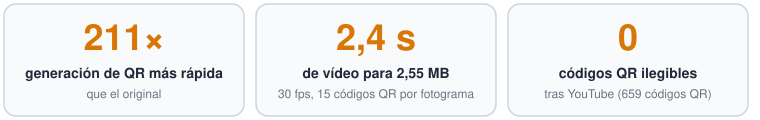
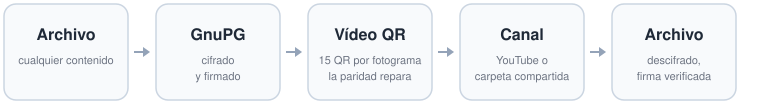
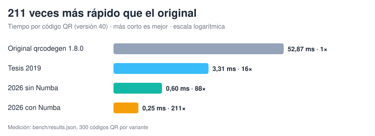
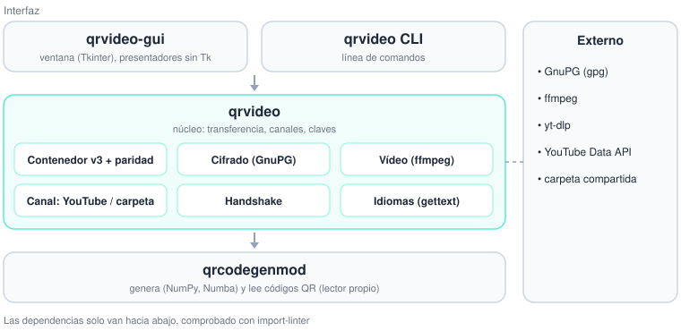

<p align="center"></p>

<h1 align="center">Thesis Revival 2026</h1>

<p align="center"><b>Enviar archivos cifrados como un vídeo de códigos QR, por YouTube o por una carpeta compartida.</b></p>

<p align="center">
  <a href="pyproject.toml"></a>
  <a href="LICENSE"></a>
  <a href="#idiomas"></a>
  
</p>

<p align="center"><a href="README.de.md">Deutsch</a> · <a href="README.md">English</a></p>

Recuperación de una tesis de grado de 2019: los archivos se cifran y firman con GnuPG, se codifican como un
vídeo de códigos QR, se transfieren por YouTube o por una carpeta compartida y el destinatario los recupera.
Reconstruido desde cero en 2026: más rápido, tolerante a la pérdida de fotogramas enteros, con interfaz
gráfica y línea de comandos en tres idiomas.

**Primeros pasos:** instalación y uso paso a paso, con capturas de pantalla, en la
[Guía de usuario](docs/GUIA_DE_USUARIO.md).

## De un vistazo

<p align="center"></p>

<p align="center"></p>

<p align="center"></p>

## Arquitectura

<p align="center"></p>

| Parte | Ubicación |
|---|---|
| Biblioteca moderna `qrcodegenmod` (Python ≥ 3.11) | `src/qrcodegenmod/` |
| Herramienta de transferencia `qrvideo` (orden `qrvideo`) | `src/qrvideo/` |
| Interfaz gráfica (orden `qrvideo-gui`) | `src/qrvideo_gui/` |
| Código de la tesis de 2019 (sin cambios) | `legacy/` |
| Guía de usuario | [`docs/GUIA_DE_USUARIO.md`](docs/GUIA_DE_USUARIO.md) (inglés: [`docs/USER_GUIDE.md`](docs/USER_GUIDE.md), alemán: [`docs/BEDIENUNGSANLEITUNG.md`](docs/BEDIENUNGSANLEITUNG.md)) |
| Arquitectura, decisiones (ADR), modelo de amenazas (en alemán) | [`docs/architecture/`](docs/architecture/), [`docs/security/`](docs/security/THREAT_MODEL.md) |

## Inicio rápido

Requisitos: [uv](https://docs.astral.sh/uv/) (descarga Python ≥ 3.11 si hace falta) y, para enviar y
recibir, GnuPG ≥ 2.4.9 (Gpg4win en Windows). ffmpeg viene con `imageio-ffmpeg`.

```powershell
git clone https://github.com/gitnol/qrvideo.git
cd qrvideo
uv sync --all-extras
uv run qrvideo-gui                     # abrir la ventana
uv run pytest                          # pruebas
uv run python bench/bench_qrcode.py    # medir la velocidad
```

Si la carpeta se sincroniza (p. ej. con un cliente en la nube), coloque el entorno virtual fuera con
`UV_PROJECT_ENVIRONMENT`.

Como biblioteca:

```python
import qrcodegenmod as q

qr = q.QrCode.encode_text("Hola tesis", q.Ecc.LOW)
img = qr.to_image(scale=2, border=2)  # uint8, oscuro = 0, claro = 255
```

## Interfaz gráfica (`qrvideo-gui`)

Para quien prefiera no usar la línea de órdenes: una ventana con las pestañas Enviar, Recibir, Handshake y
Claves, en español, alemán o inglés (menú «Idioma», `--lang`). Paso a paso, incluida la configuración de GnuPG:
[Guía de usuario](docs/GUIA_DE_USUARIO.md).

```powershell
uv run qrvideo-gui --lang es
```

## Transferir archivos (`qrvideo`)

Requisitos: GnuPG ≥ 2.4.9 (en Windows: Gpg4win), claves de confianza del remitente y del destinatario.
gpg-agent pide la frase de contraseña; use `QRVIDEO_PASSPHRASE` solo en ejecuciones desatendidas. Idioma de la
salida: `--lang de|en|es` o `QRVIDEO_LANG`; si no, el idioma del sistema.

```powershell
uv run qrvideo keys                                              # claves de confianza
uv run qrvideo send informe.xlsx -r <KeyID> --sign <KeyID> -o informe.mp4   # formato v3: ECC L, 10 % de paridad
uv run qrvideo send informe.xlsx -r <KeyID> --sign <KeyID> -o informe.mp4 --parity 0 --ecc M  # formato v2
uv run qrvideo upload informe.mp4 --client-secrets client_secret.json   # oculto
uv run qrvideo download https://youtu.be/<ID> -d entrada
uv run qrvideo download https://youtu.be/<ID> -d entrada --cookies-from-browser firefox   # vídeo privado
uv run qrvideo upload informe.mp4 --channel folder --folder \\servidor\intercambio   # carpeta compartida en lugar de YouTube
uv run qrvideo download qrvideo-<8 hex>.mp4 --channel folder --folder \\servidor\intercambio -d entrada
uv run qrvideo receive entrada/<ID>.mp4 -o entrada   # el archivo recupera su nombre (viaja cifrado)
uv run qrvideo decode video_tesis_2019.mp4 -o antiguo.pgp --legacy  # vídeos en el formato de la tesis
uv run qrvideo challenge oferta/ -r <KeyID> --sign <KeyID> -o challenge.asc --png challenge.png
uv run qrvideo respond challenge.png --select 0 --sign <KeyID> -o response.asc
```

| Métrica (medida el 26-10-2026) | Tesis 2019 | 2026 |
|---|---|---|
| Generar un código QR (V40, 2100 caracteres) | 3,32 ms | 0,25 ms |
| Bytes útiles por código QR (ECC M) | 1575 (Base64) | 2331 (binario) |
| Tolerancia a fallos entre fotogramas | ninguna | por defecto (ECC L, 10 % de paridad): 1 fotograma perdido de cada 10, con un vídeo un 8,9 % más corto que v2 con ECC M |
| Leer el vídeo original de YouTube de la tesis | pyzbar + corrección | lector propio, 0 fallos, 1,4 s |

Nota para scripts propios en Windows: el codificador usa un grupo de procesos, así que el script que lo llama
necesita `if __name__ == "__main__":`.

## Idiomas

La interfaz gráfica y la línea de órdenes hablan alemán, inglés y español. Los textos originales del código están
en inglés; cada idioma es un catálogo `gettext` en `src/qrvideo/locale/<idioma>/LC_MESSAGES/qrvideo.po`
(decisión ADR-006). Una prueba comprueba que todos los textos están traducidos en todos los idiomas, que los
marcadores `{nombre}` coinciden y que los archivos `.mo` están actualizados.

Añadir un idioma (p. ej. francés, `fr`):

1. Añadir `"fr"` a `SUPPORTED` en `src/qrvideo/i18n.py`, a `LANGUAGES` en `tools/i18n_catalog.py` y su nombre a
   `LANGUAGE_NAMES` en `src/qrvideo_gui/app.py`; para las cifras, una entrada en `_NUMBERS` de `i18n.py`.
2. `uv run python tools/i18n_catalog.py update` crea `fr/LC_MESSAGES/qrvideo.po` con todos los textos vacíos.
3. Traducir el `.po` (a mano o con Poedit) y volver a ejecutar `update`, que compila el `.mo`.
4. `uv run pytest tests/test_i18n_catalog.py` indica lo que falta.
5. Capturas de pantalla: `uv run --with pillow python tools/screenshots.py --lang fr` (antes, añadir los datos de
   demostración del idioma en `DEMO`).

Las traducciones al español no han sido revisadas por una persona nativa; las correcciones del `.po` son muy
bienvenidas.

## Agradecimiento a Project Nayuki

El núcleo de este proyecto es `qrcodegenmod`, una bifurcación de la excelente
[**QR Code generator library**](https://github.com/nayuki/QR-Code-generator) de
[Project Nayuki](https://www.nayuki.io/page/qr-code-generator-library) (licencia MIT), commit base
[`6e088f7`](https://github.com/nayuki/QR-Code-generator/commit/6e088f7) del 13-09-2019.

La biblioteca de Nayuki es un modelo de cómo implementar un estándar: completa según ISO/IEC 18004, con el mismo
comportamiento en varios lenguajes, sin dependencias y escrita con tanta claridad que cada paso (segmentos,
Reed-Solomon, máscaras, penalizaciones) se puede seguir directamente. Esa claridad hizo posible la tesis de 2019:
su base limpia permitió añadir las optimizaciones de forma precisa. La modernización de 2026 también se apoya en
ella: el `qrcodegen` 1.8.0 oficial sirve de oráculo para las pruebas, y `qrcodegenmod` genera códigos QR idénticos
bit a bit en todas las versiones, niveles de corrección de errores y máscaras.

Muchas gracias a Nayuki por este gran trabajo y por ponerlo a disposición de todos.

El proyecto se desarrolló siguiendo un proceso interno de documentación (estado, reflexiones, registro de
cambios). Esos registros no forman parte de este repositorio; las referencias a ellos en `docs/` apuntan a ese
material interno.
