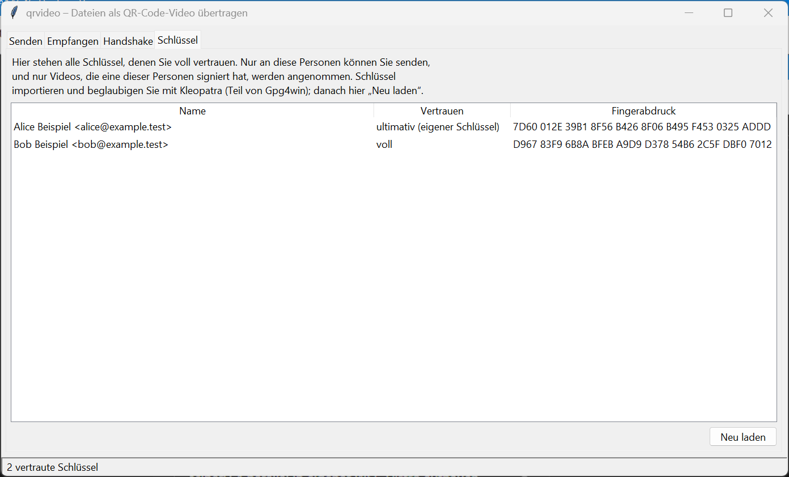
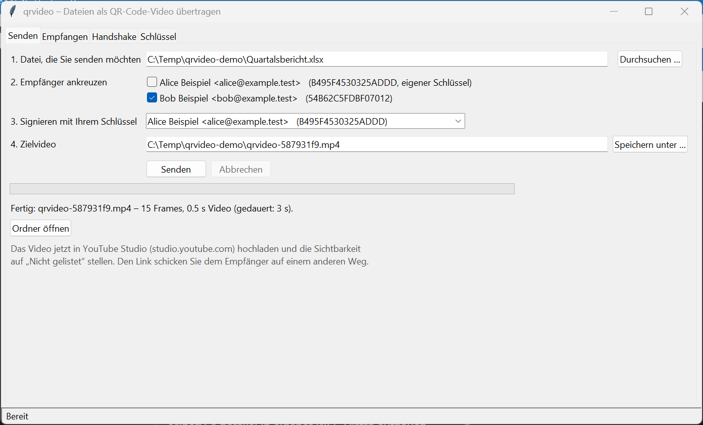
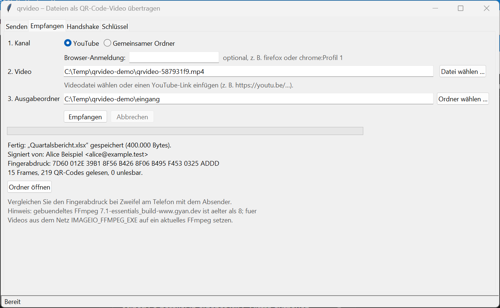
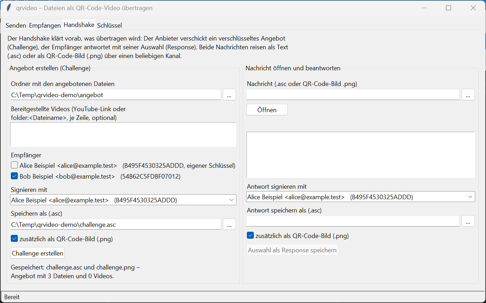
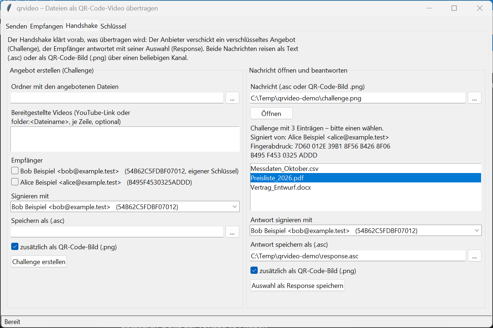

# Bedienungsanleitung – qrvideo

*English version: [USER_GUIDE.md](USER_GUIDE.md)*

Für alle, die Dateien mit `qrvideo` verschlüsselt als Video übertragen möchten. Vorwissen über das Projekt ist
nicht nötig. Teil 1–9 beschreiben die Bedienoberfläche, der Anhang die Kommandozeile. Die Bilder zeigen
Demo-Schlüssel („Alice Beispiel“, „Bob Beispiel“).

---

## 1. Worum es geht

`qrvideo` verschlüsselt eine Datei für bestimmte Empfänger, signiert sie mit Ihrem Schlüssel und schreibt sie als
Video aus QR-Codes. Das Video laden Sie z. B. als „nicht gelistet“ auf YouTube hoch oder legen es in einen
gemeinsamen Ordner. Der Empfänger liest das Video wieder ein und erhält die Datei – aber nur, wenn sie an ihn
gerichtet ist und von jemandem stammt, dem er vertraut.

```
Datei ──► verschlüsseln + signieren ──► QR-Code-Video ──► YouTube / Ordner ──► Video einlesen ──► Datei
```

Ein Video verkraftet Bildfehler: Jeder QR-Code korrigiert selbst kleine Fehler, und je 10 Frames darf ein
ganzer Frame verloren gehen. Eine Datei von 10 MB ergibt knapp 10 Sekunden Video.

---

## 2. Einmal einrichten

### 2.1 Programme installieren

1. **Gpg4win** von [gpg4win.org](https://gpg4win.org) installieren (enthält GnuPG und Kleopatra). Benötigt wird
   GnuPG 2.4.9 oder neuer.
2. **uv** installieren ([docs.astral.sh/uv](https://docs.astral.sh/uv/)).
3. Im Projektordner einmal in PowerShell:

   ```powershell
   [Environment]::SetEnvironmentVariable("UV_PROJECT_ENVIRONMENT", "$env:LOCALAPPDATA\venvs\revival_2026", "User")
   $env:UV_PROJECT_ENVIRONMENT = "$env:LOCALAPPDATA\venvs\revival_2026"
   uv sync
   ```

   Die Programmumgebung liegt damit außerhalb des (synchronisierten) Projektordners.

### 2.2 Eigenen Schlüssel anlegen

In Kleopatra: **Datei → Neues OpenPGP-Schlüsselpaar**, Name und E-Mail eintragen, eine gute Passphrase wählen.
Diesen Schlüssel nutzen Sie zum Signieren; an ihn werden Dateien für Sie verschlüsselt.

### 2.3 Schlüssel mit Ihren Partnern austauschen

Senden und empfangen können Sie nur mit Personen, deren Schlüssel Sie **beglaubigt** haben:

1. Öffentlichen Schlüssel exportieren (Kleopatra: Rechtsklick → **Exportieren**) und dem Partner geben;
   seinen öffentlichen Schlüssel importieren (**Importieren**).
2. Den **Fingerabdruck** am Telefon oder persönlich vergleichen (40 Zeichen, Kleopatra zeigt ihn in
   Vierergruppen).
3. Stimmt er, den Schlüssel des Partners **beglaubigen** (Rechtsklick → **Beglaubigen**).

Erst dann gilt der Schlüssel als „voll vertraut“ und erscheint in `qrvideo`.

### 2.4 Programm starten

```powershell
uv run qrvideo-gui
```

Es öffnet sich das Fenster „qrvideo – Dateien als QR-Code-Video übertragen“ mit vier Reitern. Daneben bleibt
ein Konsolenfenster offen; dort stehen technische Details, falls etwas schiefgeht. Bitte nicht schließen.

---

## 3. Reiter „Schlüssel“

Zeigt alle Schlüssel, denen Sie voll vertrauen: Name, Vertrauensstufe, Fingerabdruck in Vierergruppen. Ihr eigener
Schlüssel steht oben („ultimativ (eigener Schlüssel)“). Nach Änderungen in Kleopatra auf **Neu laden** klicken.

Fehlt ein Partner hier, haben Sie seinen Schlüssel noch nicht beglaubigt (Abschnitt 2.3).



*Reiter „Schlüssel“ aus Sicht von Alice: ihr eigener Schlüssel und der beglaubigte von Bob.*

---

## 4. Datei senden (Reiter „Senden“)

1. **Datei, die Sie senden möchten:** über **Durchsuchen …** wählen.
2. **Empfänger ankreuzen:** eine oder mehrere Personen. Jede kann die Datei später allein öffnen.
3. **Signieren mit Ihrem Schlüssel:** ist mit Ihrem Schlüssel vorbelegt.
4. **Zielvideo:** vorgeschlagen wird `qrvideo-<8 Zeichen>.mp4` neben der Datei. Der Name verrät absichtlich
   nichts über den Inhalt; der Originalname reist verschlüsselt mit.
5. **Senden** klicken. GnuPG fragt in einem eigenen Fenster nach Ihrer Passphrase.

Während der Arbeit zeigt ein Balken „Frame n von N“; **Abbrechen** beendet den Vorgang, dann wird kein Video
gespeichert. Gibt es das Zielvideo schon, fragt das Programm vor dem Überschreiben. Am Ende stehen Name, Anzahl
Frames und Länge des Videos da; **Ordner öffnen** zeigt es im Explorer.



*Alice hat eine Datei für Bob als Video geschrieben. Darunter der Hinweis zum Hochladen.*

---

## 5. Video übertragen

### Über YouTube

1. [studio.youtube.com](https://studio.youtube.com) öffnen → **Erstellen → Videos hochladen**, das `.mp4` wählen.
2. Sichtbarkeit **„Nicht gelistet“** einstellen. Titel und Beschreibung frei lassen oder neutral wählen.
3. Warten, bis YouTube die HD-Fassung (1080p) fertig verarbeitet hat; davor ist das Video nicht lesbar.
4. Den Link dem Empfänger auf einem anderen Weg schicken (Mail, Messenger).

Private Videos lassen sich ebenfalls abholen, wenn der Empfänger im Browser bei YouTube angemeldet ist und Zugriff
hat (Abschnitt 6, „Browser-Anmeldung“).

### Über einen gemeinsamen Ordner

Das Video einfach in einen Ordner kopieren, den beide erreichen (Netzlaufwerk, NextCloud, USB-Stick), und dem
Empfänger den Dateinamen nennen.

---

## 6. Datei empfangen (Reiter „Empfangen“)

1. **Kanal** wählen: **YouTube** oder **Gemeinsamer Ordner**. Es erscheinen nur die passenden Felder.
   - YouTube, optional **Browser-Anmeldung:** nur für private Videos, z. B. `firefox` oder `chrome`, bei mehreren
     Profilen `firefox:Profilname`. Sonst leer lassen.
   - Gemeinsamer Ordner: **Kanal-Ordner** über **Ordner wählen …** angeben.
2. **Video:** eine Videodatei über **Datei wählen …**, einen YouTube-Link (`https://youtu.be/…`) oder den
   Dateinamen im Kanal-Ordner.
3. **Ausgabeordner:** Vorgabe ist „Downloads“.
4. **Empfangen** klicken. GnuPG fragt nach Ihrer Passphrase.

Das Ergebnis nennt Dateiname, Größe, **Signiert von** und den **Fingerabdruck** des Absenders. Vergleichen Sie ihn
bei Zweifel am Telefon. Die Datei bekommt ihren Originalnamen; ist der schon belegt, heißt sie `name (2).endung`.
Vorhandene Dateien werden nie überschrieben.



*Bob hat das Video eingelesen: Originalname, Absender Alice und ihr Fingerabdruck. Der graue Hinweis zu FFmpeg ist nur eine Warnung (Abschnitt 8).*

Stammt das Video nicht von einer vertrauten Person oder ist es nicht an Sie gerichtet, wird **nichts** gespeichert.

---

## 7. Handshake: Dateien anbieten und auswählen lassen (Reiter „Handshake“)

Optional, für den Ablauf aus der Thesis: Sie bieten eine Liste an, der Partner wählt einen Eintrag.

**Links – Angebot erstellen (Challenge):**
1. Ordner mit den angebotenen Dateien wählen.
2. Optional bereits hochgeladene Videos eintragen, je Zeile ein YouTube-Link oder `folder:<Dateiname>`.
3. Empfänger ankreuzen, Signaturschlüssel prüfen, unter **Speichern als (.asc)** die Zieldatei wählen; auf Wunsch **zusätzlich als
   QR-Code-Bild (.png)**.
4. **Challenge erstellen** und die Datei dem Partner schicken.



*Alice bietet Bob drei Dateien an; gespeichert als Text (.asc) und QR-Code-Bild (.png).*

**Rechts – Nachricht öffnen und beantworten:**
1. Die erhaltene `.asc`- oder `.png`-Datei wählen und **Öffnen**. Angezeigt werden Absender, Fingerabdruck und die
   angebotenen Einträge.
2. Einen Eintrag wählen, **Antwort signieren mit** und **Antwort speichern als (.asc)** prüfen, dann
   **Auswahl als Response speichern**.
3. Die Antwort zurückschicken; der Anbieter öffnet sie rechts genauso.



*Bob hat das QR-Code-Bild geöffnet, sieht Absender und Fingerabdruck und wählt eine Datei aus.*

---

## 8. Wenn etwas schiefgeht

| Meldung | Was tun |
|---|---|
| „GnuPG ist nicht installiert …“ | Gpg4win installieren (Abschnitt 2.1), Programm neu starten |
| „Keine vertrauten Schlüssel gefunden“ | Schlüssel in Kleopatra importieren und beglaubigen (2.3), dann **Neu laden** |
| „Bitte mindestens einen Empfänger ankreuzen …“ | Im Reiter „Senden“ einen Empfänger ankreuzen |
| „Verschlüsseln oder Signieren war nicht möglich …“ | Ist der gewählte Signaturschlüssel Ihr eigener? Passphrase richtig eingegeben? |
| „Entschlüsseln war nicht möglich …“ | Ist die Datei an Sie gerichtet? Passphrase richtig? |
| „Die Daten stammen nicht von einem vertrauten Absender …“ | Absender-Schlüssel fehlt oder ist nicht beglaubigt – oder das Video ist nicht echt. Nichts wurde gespeichert |
| „Im Video wurden keine vollständigen Daten gefunden …“ | Ist es ein `qrvideo`-Video in 1080p? Bei YouTube die HD-Verarbeitung abwarten und erneut versuchen |
| „Download von YouTube fehlgeschlagen …“ | Link prüfen; bei privaten Videos die Browser-Anmeldung angeben |
| „Kein Zugriff … Ist die Datei in einem anderen Programm geöffnet?“ | Datei schließen bzw. anderen Ordner wählen |
| „Unerwarteter Fehler“ | Details im Konsolenfenster; diese bitte beim Melden mitschicken |

Ein Hinweis auf ein **veraltetes FFmpeg** beim Empfangen ist eine Warnung, kein Fehler. Wer ein aktuelles FFmpeg
installiert hat, kann es über die Umgebungsvariable `IMAGEIO_FFMPEG_EXE` angeben.

---

## 9. Gut zu wissen

- **Was andere sehen:** Der Inhalt, der Dateiname und die Empfänger sind verschlüsselt. Erkennbar bleibt, dass es
  ein QR-Code-Video ist und wie groß die verschlüsselte Datei ist (die Länge steht im Klartext-Kopf).
- **Passphrase:** `qrvideo` speichert sie nie; GnuPG fragt selbst danach.
- **Nichts wird still überschrieben:** Videos nur nach Rückfrage, empfangene Dateien nie.
- **Schließen während eines Vorgangs** fragt nach und bricht ihn ab.
- **Thesis-Videos von 2019** liest nur die Kommandozeile (`decode --legacy`, siehe Anhang).

---

## Anhang: Kommandozeile

Alle Befehle im Projektordner; `uv run qrvideo <befehl> --help` zeigt alle Optionen.

| Aufgabe | Befehl |
|---|---|
| Vertraute Schlüssel anzeigen | `uv run qrvideo keys` |
| Datei senden | `uv run qrvideo send bericht.xlsx -r <Empfänger> --sign <eigener Schlüssel> -o video.mp4` |
| Video auf YouTube hochladen (API) | `uv run qrvideo upload video.mp4 --client-secrets client_secret.json` |
| Video in gemeinsamen Ordner legen | `uv run qrvideo upload video.mp4 --channel folder --folder \\server\austausch` |
| Video von YouTube holen | `uv run qrvideo download https://youtu.be/<ID> -d eingang` |
| Privates Video holen | `… download https://youtu.be/<ID> -d eingang --cookies-from-browser firefox` |
| Video aus dem Ordner holen | `uv run qrvideo download <Dateiname> --channel folder --folder \\server\austausch -d eingang` |
| Datei empfangen | `uv run qrvideo receive eingang\<Video>.mp4 -o eingang` |
| Thesis-Video lesen | `uv run qrvideo decode thesis.mp4 -o alt.pgp --legacy` |
| Challenge / Response / ansehen | `challenge`, `respond`, `inspect` (siehe `--help`) |

`-r` und `--sign` nehmen eine Schlüssel-ID oder den Fingerabdruck; `-r` darf mehrfach stehen. Ohne weitere Angaben
schreibt `send` das robuste Format v3 (ECC L, 10 % Parität); `--parity 0 --ecc M` erzeugt das ältere Format v2.

Für den Upload per API braucht es ein eigenes Google-Cloud-Projekt mit OAuth-Client. Solange Google das Projekt
nicht verifiziert hat, setzt YouTube per API hochgeladene Videos auf „privat“ – der Upload über YouTube Studio
(Abschnitt 5) ist daher meist einfacher.
