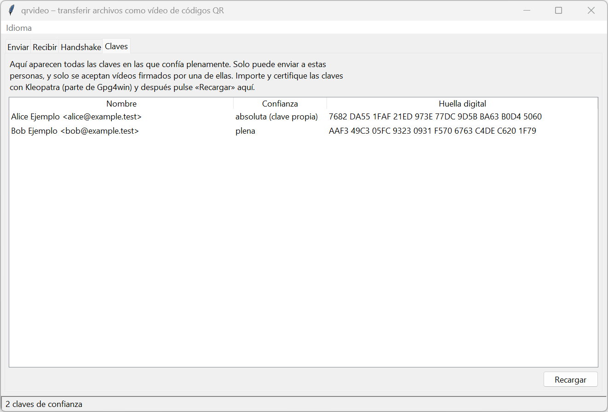
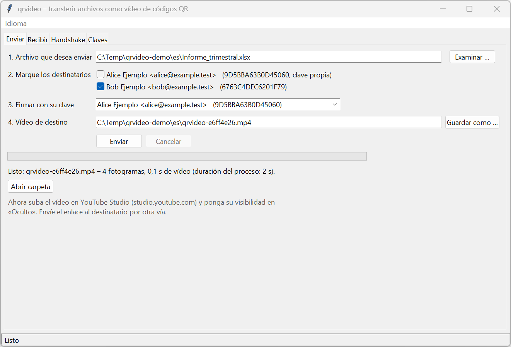
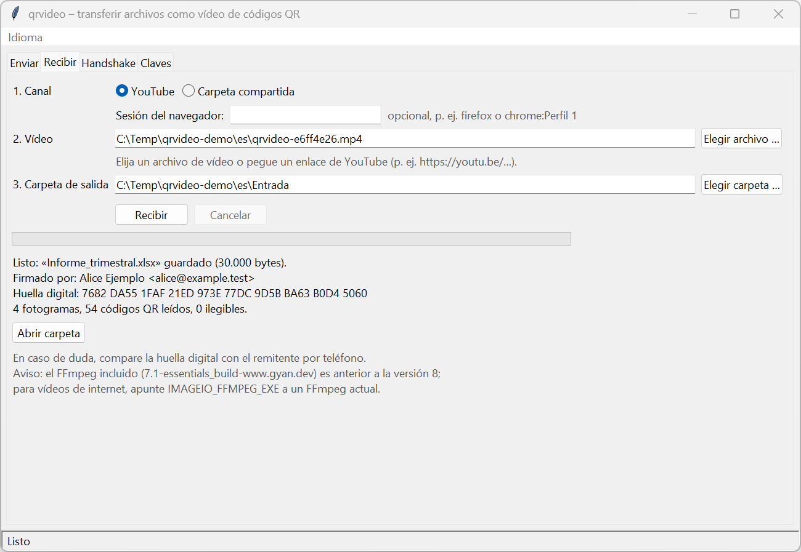
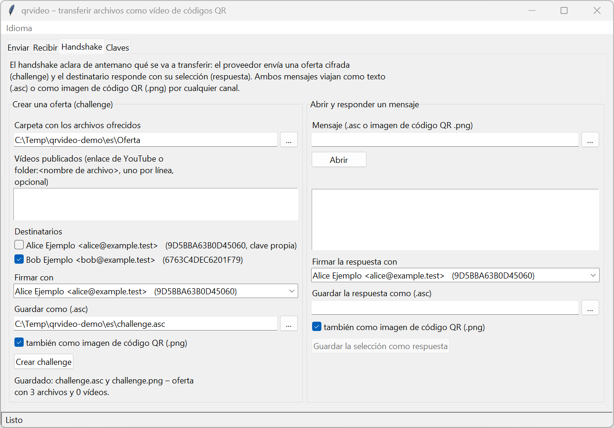
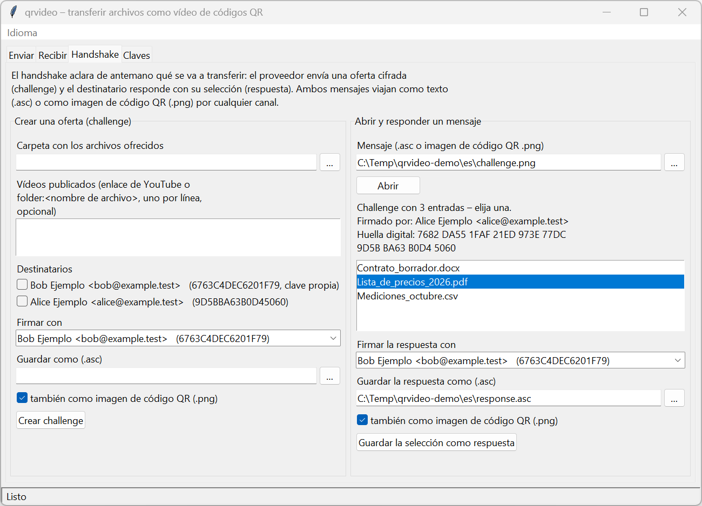

# Guía de usuario – qrvideo

*Deutsche Fassung: [BEDIENUNGSANLEITUNG.md](BEDIENUNGSANLEITUNG.md) · English version: [USER_GUIDE.md](USER_GUIDE.md)*

Para quien quiera enviar archivos cifrados como vídeo con `qrvideo`. No hace falta conocer el proyecto. Las
secciones 1–9 describen la interfaz gráfica; el anexo, la línea de órdenes. Las capturas usan claves de
demostración («Alice Ejemplo», «Bob Ejemplo»).

> Esta guía y la interfaz en español no han sido revisadas todavía por una persona nativa. Las correcciones son
> bienvenidas (véase el [README](../README.es.md#idiomas)).

---

## 1. Para qué sirve

`qrvideo` cifra un archivo para los destinatarios elegidos, lo firma con su clave y lo escribe como un vídeo
formado por códigos QR. Usted sube el vídeo, por ejemplo como «oculto» en YouTube, o lo deja en una carpeta
compartida. El destinatario vuelve a leer el vídeo y obtiene el archivo, pero solo si iba dirigido a él y procede
de alguien de su confianza.

```
Archivo ──► cifrar + firmar ──► vídeo QR ──► YouTube / carpeta ──► leer vídeo ──► archivo
```

El vídeo tolera errores de imagen: cada código QR corrige por sí mismo pequeños errores, y se puede perder un
fotograma completo de cada 10. Un archivo de 10 MB se convierte en un vídeo de algo menos de 10 segundos.

---

## 2. Configuración inicial

### 2.1 Instalar los programas

1. Instale **Gpg4win** desde [gpg4win.org](https://gpg4win.org) (incluye GnuPG y Kleopatra). Se necesita GnuPG
   2.4.9 o posterior.
2. Instale **uv** ([docs.astral.sh/uv](https://docs.astral.sh/uv/)).
3. Una sola vez, en PowerShell dentro de la carpeta del proyecto:

   ```powershell
   [Environment]::SetEnvironmentVariable("UV_PROJECT_ENVIRONMENT", "$env:LOCALAPPDATA\venvs\revival_2026", "User")
   $env:UV_PROJECT_ENVIRONMENT = "$env:LOCALAPPDATA\venvs\revival_2026"
   uv sync
   ```

   Así el entorno de Python queda fuera de la carpeta del proyecto (útil si la carpeta se sincroniza).

### 2.2 Crear su propia clave

En Kleopatra: **Archivo → Nuevo par de claves OpenPGP**, introduzca nombre y correo electrónico y elija una buena
frase de contraseña. Con esta clave usted firma, y los demás cifran para usted.

### 2.3 Intercambiar claves con sus contactos

Solo puede enviar a personas, y recibir de personas, cuya clave haya **certificado**:

1. Exporte su clave pública (Kleopatra: clic derecho → **Exportar**) y désela a su contacto; importe la suya
   (**Importar**).
2. Compare la **huella digital** por teléfono o en persona (40 caracteres; Kleopatra la muestra en grupos de
   cuatro).
3. Si coincide, **certifique** la clave de su contacto (clic derecho → **Certificar**).

Solo entonces la clave es «de plena confianza» y aparece en `qrvideo`.

### 2.4 Iniciar el programa y elegir el idioma

```powershell
uv run qrvideo-gui
```

Se abre la ventana «qrvideo – transferir archivos como vídeo de códigos QR» con cuatro pestañas. Junto a ella
permanece abierta una ventana de consola, que muestra detalles técnicos si algo falla. No la cierre.

La interfaz está disponible en español, alemán e inglés. Se inicia en el idioma del sistema. Para elegir otro,
use el menú **Idioma** (cada idioma aparece con su propio nombre: Deutsch, English, Español); la elección se
guarda y se aplica tras reiniciar. Solo para un inicio: `uv run qrvideo-gui --lang es`.

---

## 3. Pestaña «Claves»

Muestra todas las claves en las que confía plenamente: nombre, nivel de confianza y huella digital en grupos de
cuatro. Su propia clave aparece arriba («absoluta (clave propia)»). Tras hacer cambios en Kleopatra, pulse
**Recargar**.

Si falta algún contacto, todavía no ha certificado su clave (sección 2.3).



*La pestaña Claves tal como la ve Alice: su propia clave y la clave certificada de Bob.*

---

## 4. Enviar un archivo (pestaña «Enviar»)

1. **Archivo que desea enviar:** elíjalo con **Examinar …**.
2. **Marque los destinatarios:** una o varias personas. Cada una puede abrir el archivo por sí misma.
3. **Firmar con su clave:** viene preseleccionada su clave.
4. **Vídeo de destino:** se propone `qrvideo-<8 caracteres>.mp4` junto al archivo. El nombre no revela nada del
   contenido a propósito; el nombre original viaja dentro del cifrado.
5. Pulse **Enviar**. GnuPG pide su frase de contraseña en una ventana propia.

Mientras trabaja, una barra muestra «Fotograma n de N»; **Cancelar** lo detiene y no se guarda ningún vídeo. Si el
vídeo de destino ya existe, el programa pregunta antes de sobrescribirlo. Al final verá el nombre, el número de
fotogramas y la duración del vídeo; **Abrir carpeta** lo muestra en el Explorador.



*Alice ha convertido un archivo para Bob en un vídeo. Debajo, la indicación para subirlo.*

---

## 5. Transferir el vídeo

### Por YouTube

1. Abra [studio.youtube.com](https://studio.youtube.com) → **Crear → Subir vídeos** y elija el `.mp4`.
2. Ponga la visibilidad en **Oculto**. Deje el título y la descripción vacíos o neutros.
3. Espere a que YouTube termine de procesar la versión HD (1080p); antes no se puede leer el vídeo.
4. Envíe el enlace al destinatario por otro canal (correo electrónico, mensajería).

También se pueden obtener vídeos privados si el destinatario ha iniciado sesión en YouTube en su navegador y tiene
acceso (sección 6, «Sesión del navegador»).

### Por una carpeta compartida

Copie el vídeo en una carpeta a la que ambos tengan acceso (unidad de red, carpeta en la nube, memoria USB) y
comunique al destinatario el nombre del archivo.

---

## 6. Recibir un archivo (pestaña «Recibir»)

1. Elija el **Canal**: **YouTube** o **Carpeta compartida**. Solo aparecen los campos correspondientes.
   - YouTube, opcionalmente **Sesión del navegador:** solo para vídeos privados, p. ej. `firefox` o `chrome`; con
     varios perfiles, `firefox:NombreDelPerfil`. Si no, déjelo vacío.
   - Carpeta compartida: indique la **Carpeta del canal** con **Elegir carpeta …**.
2. **Vídeo:** un archivo de vídeo con **Elegir archivo …**, un enlace de YouTube (`https://youtu.be/…`) o el nombre
   del archivo en la carpeta del canal.
3. **Carpeta de salida:** por defecto «Descargas».
4. Pulse **Recibir**. GnuPG pide su frase de contraseña.

El resultado muestra el nombre del archivo, el tamaño, **Firmado por** y la **Huella digital** del remitente. En
caso de duda, compárela por teléfono. El archivo recibe su nombre original; si ese nombre ya existe, pasa a ser
`nombre (2).ext`. Nunca se sobrescriben archivos existentes.



*Bob ha leído el vídeo: nombre original, remitente Alice y su huella digital. El aviso gris sobre FFmpeg es solo
una advertencia (sección 8).*

Si el vídeo no procede de una persona de confianza o no va dirigido a usted, **no** se guarda nada.

---

## 7. Handshake: ofrecer archivos y dejar elegir al contacto (pestaña «Handshake»)

Opcional, para el procedimiento de la tesis: usted ofrece una lista y su contacto elige una entrada.

**Izquierda – Crear una oferta (challenge):**
1. Elija la **Carpeta con los archivos ofrecidos**.
2. Opcionalmente, indique **Vídeos publicados**, uno por línea: un enlace de YouTube o `folder:<nombre de
   archivo>`.
3. Marque los **Destinatarios**, revise **Firmar con** y elija el archivo de destino en **Guardar como (.asc)**;
   opcionalmente **también como imagen de código QR (.png)**.
4. Pulse **Crear challenge** y envíe el archivo a su contacto.



*Alice ofrece a Bob tres archivos, guardados como texto (.asc) y como imagen de código QR (.png).*

**Derecha – Abrir y responder un mensaje:**
1. Elija el archivo `.asc` o `.png` recibido en **Mensaje** y pulse **Abrir**. Se muestran el remitente, la huella
   digital y las entradas ofrecidas.
2. Elija una entrada, revise **Firmar la respuesta con** y **Guardar la respuesta como (.asc)** y pulse **Guardar
   la selección como respuesta**.
3. Envíe la respuesta de vuelta; quien hizo la oferta la abre a la derecha de la misma manera.



*Bob ha abierto la imagen de código QR, ve el remitente y la huella digital y elige un archivo.*

---

## 8. Solución de problemas

| Mensaje | Qué hacer |
|---|---|
| «GnuPG no está instalado …» | Instale Gpg4win (sección 2.1) y reinicie el programa |
| «No se encontraron claves de confianza» | Importe y certifique claves en Kleopatra (2.3) y pulse **Recargar** |
| «Marque al menos un destinatario …» | Marque un destinatario en la pestaña Enviar |
| «No se pudo cifrar o firmar …» | ¿Es suya la clave de firma elegida? ¿Es correcta la frase de contraseña? |
| «No se pudo descifrar …» | ¿Va dirigido a usted el archivo? ¿Es correcta la frase de contraseña? |
| «Los datos no proceden de un remitente de confianza …» | Falta la clave del remitente o no está certificada, o el vídeo no es auténtico. No se ha guardado nada |
| «No se encontraron datos completos en el vídeo …» | ¿Es un vídeo de `qrvideo` en 1080p? En YouTube, espere al procesamiento HD y vuelva a intentarlo |
| «Error al descargar de YouTube …» | Compruebe el enlace; para vídeos privados, indique la sesión del navegador |
| «Sin acceso … ¿Está el archivo abierto en otro programa?» | Cierre el archivo o elija otra carpeta |
| «Error inesperado» | Los detalles están en la ventana de la consola; inclúyalos al informar del problema |

Un aviso sobre un **FFmpeg antiguo** al recibir es una advertencia, no un error. Si tiene instalado un FFmpeg
actual, indique su ruta en la variable de entorno `IMAGEIO_FFMPEG_EXE`.

---

## 9. Conviene saber

- **Qué pueden ver otros:** el contenido, el nombre del archivo y los destinatarios están cifrados. Solo se ve que
  es un vídeo de códigos QR y el tamaño del archivo cifrado (la longitud figura en la cabecera sin cifrar).
- **Frase de contraseña:** `qrvideo` nunca la guarda; GnuPG la pide por sí mismo.
- **Nada se sobrescribe sin avisar:** los vídeos solo tras preguntar, los archivos recibidos nunca.
- **Cerrar la ventana durante una tarea** pregunta primero y después la cancela.
- **Los vídeos de la tesis de 2019** solo se leen desde la línea de órdenes (`decode --legacy`, véase el anexo).
- **Idiomas:** la línea de órdenes también habla español, alemán e inglés (`--lang` o la variable de entorno
  `QRVIDEO_LANG`). El [README](../README.es.md#idiomas) explica cómo añadir un idioma.

---

## Anexo: línea de órdenes

Ejecute todas las órdenes en la carpeta del proyecto; `uv run qrvideo <orden> --help` muestra todas las opciones.

| Tarea | Orden |
|---|---|
| Mostrar las claves de confianza | `uv run qrvideo keys` |
| Enviar un archivo | `uv run qrvideo send informe.xlsx -r <destinatario> --sign <clave propia> -o video.mp4` |
| Subir el vídeo a YouTube (API) | `uv run qrvideo upload video.mp4 --client-secrets client_secret.json` |
| Dejar el vídeo en una carpeta compartida | `uv run qrvideo upload video.mp4 --channel folder --folder \\servidor\intercambio` |
| Obtener el vídeo de YouTube | `uv run qrvideo download https://youtu.be/<ID> -d entrada` |
| Obtener un vídeo privado | `… download https://youtu.be/<ID> -d entrada --cookies-from-browser firefox` |
| Obtener el vídeo de la carpeta | `uv run qrvideo download <nombre de archivo> --channel folder --folder \\servidor\intercambio -d entrada` |
| Recibir un archivo | `uv run qrvideo receive entrada\<video>.mp4 -o entrada` |
| Leer un vídeo de la tesis | `uv run qrvideo decode tesis.mp4 -o antiguo.pgp --legacy` |
| Challenge / respuesta / inspección | `challenge`, `respond`, `inspect` (véase `--help`) |
| Salida en otro idioma | `uv run qrvideo --lang es keys` |

`-r` y `--sign` aceptan un ID de clave o una huella digital; `-r` se puede indicar varias veces. Por defecto,
`send` escribe el formato robusto v3 (ECC L, 10 % de paridad); `--parity 0 --ecc M` genera el formato anterior v2.

Subir mediante la API requiere un proyecto propio de Google Cloud con un cliente OAuth. Mientras Google no haya
verificado el proyecto, YouTube marca como «privados» los vídeos subidos por la API; por eso suele ser más
sencillo subirlos con YouTube Studio (sección 5).
