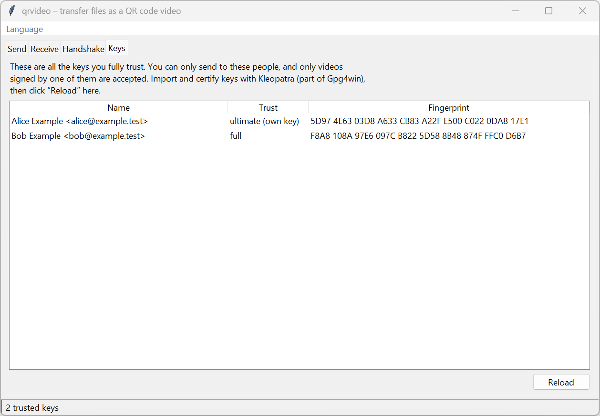
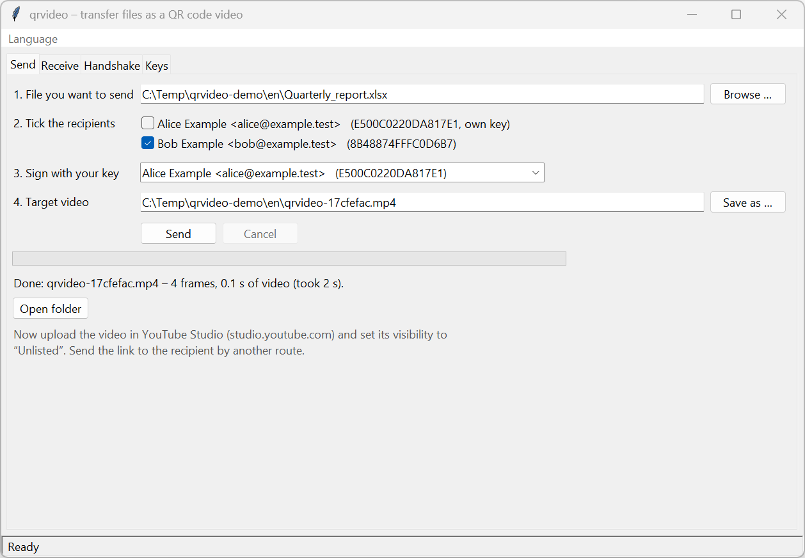
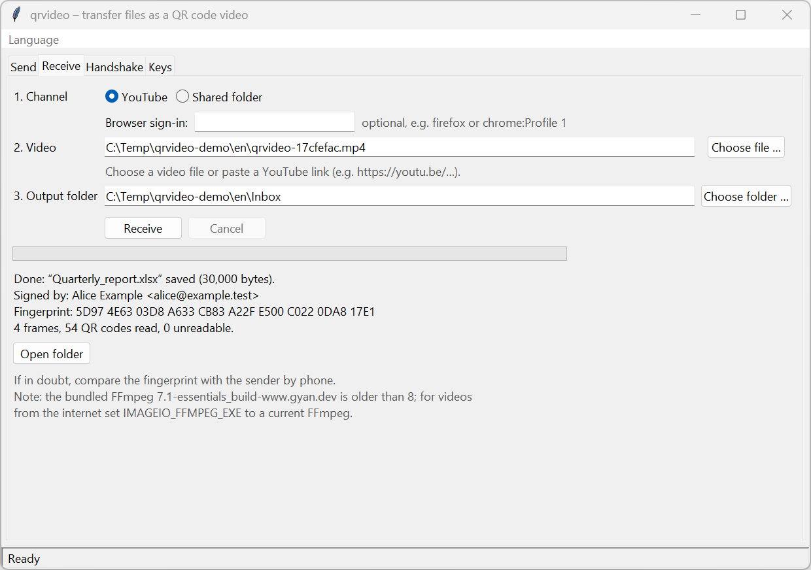
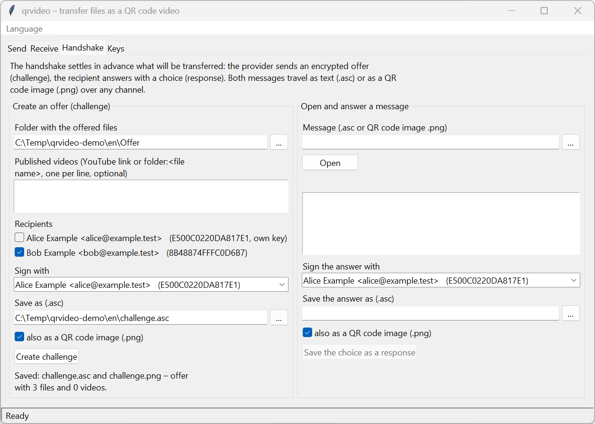
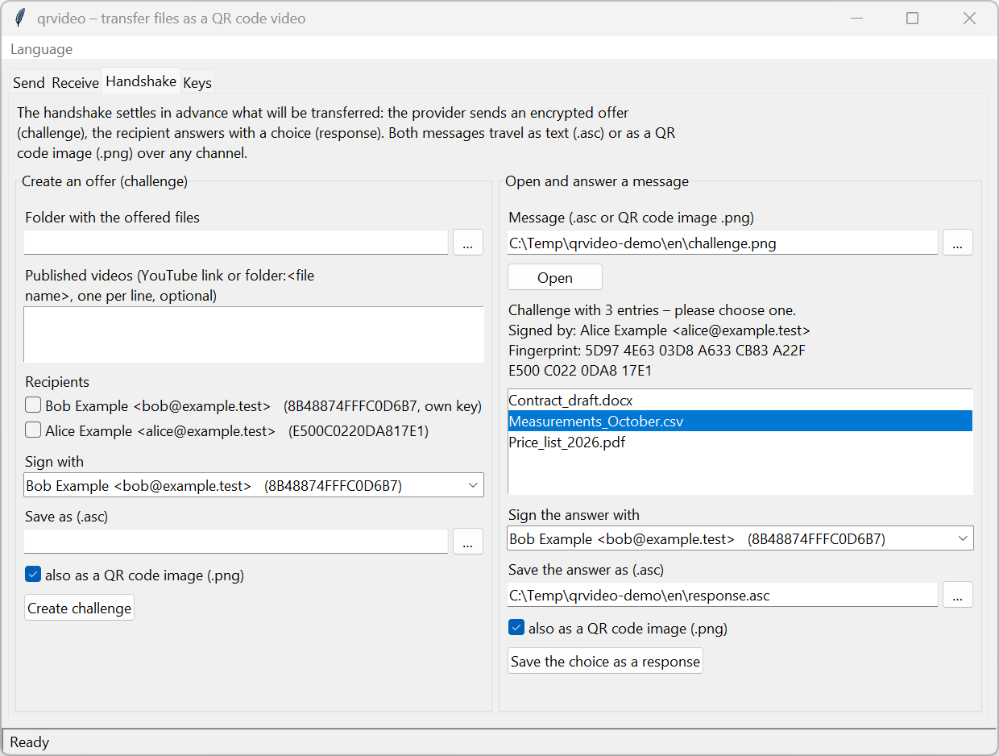

# User Guide – qrvideo

*Deutsche Fassung: [BEDIENUNGSANLEITUNG.md](BEDIENUNGSANLEITUNG.md) · Versión en español:
[GUIA_DE_USUARIO.md](GUIA_DE_USUARIO.md)*

For anyone who wants to send files with `qrvideo` as an encrypted video. No prior knowledge of the project is
needed. Sections 1–9 cover the graphical interface, the appendix covers the command line. The screenshots use
demo keys ("Alice Example", "Bob Example").

---

## 1. What it does

`qrvideo` encrypts a file for selected recipients, signs it with your key and writes it as a video made of QR
codes. You upload the video, for example as "unlisted" on YouTube, or put it into a shared folder. The recipient
reads the video back in and gets the file – but only if it was meant for them and comes from someone they trust.

```
File ──► encrypt + sign ──► QR-code video ──► YouTube / folder ──► read video ──► file
```

A video tolerates picture errors: every QR code corrects small errors by itself, and one whole frame in every 10
may be lost. A 10 MB file becomes a video of just under 10 seconds.

---

## 2. One-time setup

### 2.1 Install the programs

1. Install **Gpg4win** from [gpg4win.org](https://gpg4win.org) (includes GnuPG and Kleopatra). GnuPG 2.4.9 or
   newer is required.
2. Install **uv** ([docs.astral.sh/uv](https://docs.astral.sh/uv/)).
3. Once, in PowerShell inside the project folder:

   ```powershell
   [Environment]::SetEnvironmentVariable("UV_PROJECT_ENVIRONMENT", "$env:LOCALAPPDATA\venvs\revival_2026", "User")
   $env:UV_PROJECT_ENVIRONMENT = "$env:LOCALAPPDATA\venvs\revival_2026"
   uv sync
   ```

   This keeps the Python environment outside the project folder (useful if the folder is synchronised).

### 2.2 Create your own key

In Kleopatra: **File → New OpenPGP Key Pair**, enter name and e-mail, choose a good passphrase. You sign with this
key, and others encrypt files for you to it.

### 2.3 Exchange keys with your partners

You can only send to and receive from people whose key you have **certified**:

1. Export your public key (Kleopatra: right-click → **Export**) and give it to your partner; import theirs
   (**Import**).
2. Compare the **fingerprint** by phone or in person (40 characters, Kleopatra shows it in groups of four).
3. If it matches, **certify** your partner's key (right-click → **Certify**).

Only then is the key "fully trusted" and appears in `qrvideo`.

### 2.4 Start the program and choose the language

```powershell
uv run qrvideo-gui
```

The window "qrvideo – transfer files as a QR code video" opens with four tabs. A console window stays open next to
it; it shows technical details if something goes wrong. Please do not close it.

The interface is available in English, German and Spanish. It starts in the language of your system. Choose
another one in the **Language** menu (each language is listed under its own name: Deutsch, English, Español);
the choice is saved and takes effect after a restart. For a single start: `uv run qrvideo-gui --lang en`.

---

## 3. Tab "Keys"

Shows all keys you fully trust: name, trust level, fingerprint in groups of four. Your own key is at the top
("ultimate (own key)"). After changes in Kleopatra, click **Reload**.

If a partner is missing here, you have not certified their key yet (section 2.3).



*The Keys tab as Alice sees it: her own key and Bob's certified key.*

---

## 4. Send a file (tab "Send")

1. **File you want to send:** choose it with **Browse …**.
2. **Tick the recipients:** one or more people. Each of them can open the file on their own.
3. **Sign with your key:** preset to your key.
4. **Target video:** the suggestion is `qrvideo-<8 characters>.mp4` next to the file. The name deliberately reveals
   nothing about the content; the original file name travels inside the encryption.
5. Click **Send**. GnuPG asks for your passphrase in its own window.

While it works, a bar shows "Frame n of N"; **Cancel** stops it and no video is saved. If the target video already
exists, the program asks before overwriting it. At the end you see the name, number of frames and length of the
video; **Open folder** shows it in Explorer.



*Alice has written a file for Bob as a video. Below it, the hint for uploading.*

---

## 5. Transfer the video

### Via YouTube

1. Open [studio.youtube.com](https://studio.youtube.com) → **Create → Upload videos**, choose the `.mp4`.
2. Set visibility to **Unlisted**. Leave title and description empty or neutral.
3. Wait until YouTube has finished processing the HD version (1080p); before that the video cannot be read.
4. Send the link to the recipient through another channel (e-mail, messenger).

Private videos can be fetched as well if the recipient is signed in to YouTube in their browser and has access
(section 6, "Browser sign-in").

### Via a shared folder

Copy the video into a folder both of you can reach (network drive, cloud folder, USB stick) and tell the recipient
the file name.

---

## 6. Receive a file (tab "Receive")

1. Choose the **Channel**: **YouTube** or **Shared folder**. Only the matching fields appear.
   - YouTube, optional **Browser sign-in:** only for private videos, e.g. `firefox` or `chrome`, with several
     profiles `firefox:ProfileName`. Otherwise leave empty.
   - Shared folder: set the **Channel folder** with **Choose folder …**.
2. **Video:** a video file via **Choose file …**, a YouTube link (`https://youtu.be/…`) or the file name in the
   channel folder.
3. **Output folder:** defaults to "Downloads".
4. Click **Receive**. GnuPG asks for your passphrase.

The result shows the file name, size, **Signed by** and the sender's **Fingerprint**. If in doubt, compare it by
phone. The file gets its original name; if that name is taken, it becomes `name (2).ext`. Existing files are never
overwritten.



*Bob has read the video: original name, sender Alice and her fingerprint. The grey FFmpeg note is only a warning
(section 8).*

If the video does not come from a trusted person or is not addressed to you, **nothing** is saved.

---

## 7. Handshake: offer files and let the partner choose (tab "Handshake")

Optional, for the workflow from the thesis: you offer a list, your partner picks an entry.

**Left – Create an offer (challenge):**
1. Choose the **Folder with the offered files**.
2. Optionally enter **Published videos**, one per line: a YouTube link or `folder:<file name>`.
3. Tick **Recipients**, check **Sign with**, choose the target file under **Save as (.asc)**; optionally
   **also as a QR code image (.png)**.
4. Click **Create challenge** and send the file to your partner.



*Alice offers Bob three files, saved as text (.asc) and QR code image (.png).*

**Right – Open and answer a message:**
1. Choose the received `.asc` or `.png` file under **Message** and click **Open**. Sender, fingerprint and the
   offered entries are shown.
2. Pick an entry, check **Sign the answer with** and **Save the answer as (.asc)**, then click **Save the choice as
   a response**.
3. Send the answer back; the offering side opens it on the right in the same way.



*Bob has opened the QR code image, sees sender and fingerprint and picks a file.*

---

## 8. Troubleshooting

| Message | What to do |
|---|---|
| "GnuPG is not installed …" | Install Gpg4win (section 2.1), restart the program |
| "No trusted keys found" | Import and certify keys in Kleopatra (2.3), then **Reload** |
| "Please tick at least one recipient …" | Tick a recipient in the Send tab |
| "Encrypting or signing was not possible …" | Is the selected signing key your own? Passphrase correct? |
| "Decryption was not possible …" | Is the file addressed to you? Passphrase correct? |
| "The data does not come from a trusted sender …" | Sender's key missing or not certified – or the video is not genuine. Nothing was saved |
| "No complete data was found in the video …" | Is it a `qrvideo` video in 1080p? On YouTube, wait for HD processing and try again |
| "Download from YouTube failed …" | Check the link; for private videos set the browser sign-in |
| "No access … Is the file open in another program?" | Close the file or choose another folder |
| "Unexpected error" | Details are in the console window; please include them when reporting |

A note about an **outdated FFmpeg** when receiving is a warning, not an error. If you have a current FFmpeg
installed, point the environment variable `IMAGEIO_FFMPEG_EXE` to it.

---

## 9. Good to know

- **What others can see:** content, file name and recipients are encrypted. Visible are only that it is a QR-code
  video and the size of the encrypted file (the length is in the plain-text header).
- **Passphrase:** `qrvideo` never stores it; GnuPG asks for it itself.
- **Nothing is overwritten silently:** videos only after asking, received files never.
- **Closing the window during an operation** asks first and then cancels it.
- **Thesis videos from 2019** can only be read on the command line (`decode --legacy`, see appendix).
- **Languages:** the command line also speaks English, German and Spanish (`--lang`, or the environment variable
  `QRVIDEO_LANG`). The [README](../README.md#languages) explains how to add a language.

---

## Appendix: command line

Run all commands in the project folder; `uv run qrvideo <command> --help` lists all options.

| Task | Command |
|---|---|
| Show trusted keys | `uv run qrvideo keys` |
| Send a file | `uv run qrvideo send report.xlsx -r <recipient> --sign <own key> -o video.mp4` |
| Upload video to YouTube (API) | `uv run qrvideo upload video.mp4 --client-secrets client_secret.json` |
| Put video into a shared folder | `uv run qrvideo upload video.mp4 --channel folder --folder \\server\exchange` |
| Fetch video from YouTube | `uv run qrvideo download https://youtu.be/<ID> -d inbox` |
| Fetch a private video | `… download https://youtu.be/<ID> -d inbox --cookies-from-browser firefox` |
| Fetch video from the folder | `uv run qrvideo download <file name> --channel folder --folder \\server\exchange -d inbox` |
| Receive a file | `uv run qrvideo receive inbox\<video>.mp4 -o inbox` |
| Read a thesis video | `uv run qrvideo decode thesis.mp4 -o old.pgp --legacy` |
| Challenge / response / inspect | `challenge`, `respond`, `inspect` (see `--help`) |
| Output in another language | `uv run qrvideo --lang es keys` |

`-r` and `--sign` take a key ID or fingerprint; `-r` may be given several times. By default `send` writes the
robust format v3 (ECC L, 10 % parity); `--parity 0 --ecc M` produces the older format v2.

Uploading via the API needs your own Google Cloud project with an OAuth client. Until Google has verified the
project, YouTube sets videos uploaded via the API to "private" – uploading through YouTube Studio (section 5) is
therefore usually easier.
