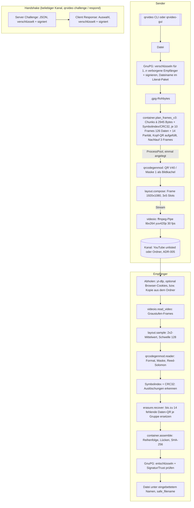

# Architektur-Übersicht – Revival_2026 (QR-Code-Videokanal)

Wiederbelebung einer Bachelor-Thesis von 2019 zum Datenaustausch über Videos aus QR-Codes:
Dateien werden mit GnuPG verschlüsselt und signiert, als Folge von QR-Codes in ein Video geschrieben, über einen
Kanal übertragen (YouTube oder seit I29 ein gemeinsamer Ordner, ADR-005) und beim Empfänger wieder dekodiert und
entschlüsselt. Kern ist die optimierte QR-Code-Bibliothek
`qrcodegenmod` (Fork von nayuki/QR-Code-generator, MIT).

---

## Stack

| Schicht | Technologie |
|---------|-------------|
| Bibliothek | Python ≥ 3.11 (Entwicklung 3.13), NumPy, optional Numba (`src/qrcodegenmod/`) |
| Pipeline / PoC | Python, python-gnupg + GnuPG, imageio + ffmpeg, pyzbar, OpenCV, multiprocessing (`legacy/poc/`, Ziel `src/qrvideo/`) |
| Datenbank | keine (Dateiordner `files_*` als Ein-/Ausgang) |
| Auth | GnuPG-Schlüssel (Signatur + Trust) für Inhalte; OAuth 2.0 (Google) nur für den YouTube-Upload |
| Build | uv + hatchling (`pyproject.toml`), Tests pytest, Lint ruff |

---

## Scope-Grenzen — Was dieses System NICHT tut

Bewusste Negativ-Liste. Sie verhindert Scope Creep und macht
Architekturentscheidungen nachvollziehbar.

- Kein allgemeiner QR-Code-Generator: `qrcodegenmod` ist auf Version 40 / ECC LOW / Maske 1 festgelegt; für andere
  Parameter gilt das Upstream-Paket.
- Keine eigene Kryptografie: Verschlüsselung, Signatur und Vertrauen liefert ausschließlich GnuPG.
- Kein Livestreaming und keine Echtzeit-Übertragung (in der Thesis nur als Ausblick erwähnt) — Batch: Datei → Video.
- Keine Schlüsselverwaltung: Schlüssel und Ownertrust pflegt der Nutzer in seinem GnuPG-Keyring.
- Kein Webdienst (die Desktop-Oberfläche `qrvideo-gui` kam mit ADR-004 hinzu); Plattform der Thesis war Windows, Linux-Lauffähigkeit ist Ziel der Modernisierung,
  macOS wird nicht aktiv geprüft.

Änderungen an dieser Liste sind eine Architekturentscheidung → ADR erforderlich.

---

## Systemstruktur (Datenfluss)



---

## Modul-Verantwortlichkeiten

```
src/qrcodegenmod/ (2.0, ersetzt legacy/qrcodegenmod.py)
  qrcode.py   → QrCode/Ecc: Version wählen, Bitstrom, Codewörter, Maske wählen, Module setzen; to_image(), to_svg_str()
  segment.py  → QrSegment/Mode: Numeric, Alphanumeric, Byte, ECI als uint8-Bitfolgen
  _tables.py  → QR-Tabellen, GF(256)-Multiplikationstabelle, Generatorpolynome (beim Import berechnet, keine .npy)
  _layout.py  → pro Version gecacht: Funktionsmuster, Zickzack-Datenpositionen; pro (Version, ECC, Maske) fertige Vorlage
  _kernels.py → Reed-Solomon + Interleaving in einem Kernel (Numba, NumPy-Fallback), Strafpunkte für die Maskenwahl
  _rs_decode.py → Reed-Solomon-Dekodierung (Berlekamp-Massey, Chien, Forney)
  reader.py   → bekannte Modul-Matrix lesen: Formatbits, Demaskieren, De-Interleaving, RS-Korrektur, Segmente
  _jit.py     → optionales Numba (`QRCODEGENMOD_DISABLE_JIT=1` schaltet ab)
src/qrvideo/ → layout (Geometrie), container (Format v2 ADR-001, v3 ADR-003), erasure (Cauchy-RS), encoder (Pool), videoio (ffmpeg), decoder,
               crypto (GnuPG, Vertrauen per Exception), channel (Kanal-Schnittstelle, YouTube- und Ordner-Kanal, ADR-005),
               youtube (yt-dlp, Upload-API), paths (sichere Dateinamen),
               handshake (Server Challenge / Client Response), qrpng (PNG ohne Bildbibliothek, QR-PNG lesen),
               errors (`ContainerError`, seit I26), i18n (Sprache, `_`/`ngettext`, Zahlenformat; Kataloge in
               `locale/<sprache>/LC_MESSAGES/qrvideo.po|.mo`, ADR-006, seit I33c), cli (Befehl `qrvideo`: encode, decode, send, receive, keys, download,
               upload), cli_handshake (challenge, respond, inspect — seit I26 aus cli ausgelagert)
src/qrvideo_gui/ (ADR-004, Tkinter/ttk, Kernmodule unverändert) → jobs (Hintergrund-Thread, Fortschritt, Abbruch),
               errors (Ausnahme → Satz in der gewählten Sprache), keys (vertraute Schlüssel, Tk-frei), widgets (Job-Ereignisse im
               Tk-Thread), app (Hauptfenster, Befehl `qrvideo-gui`), send + send_view (Reiter „Senden“),
               receive + receive_view (Reiter „Empfangen“), handshake + handshake_view (Reiter „Handshake“),
               settings (gespeicherte Sprache, Tk-frei, seit I33i)
POC.py       → Konsolenmenü, GnuPG-Wrapper (QRCrypt), Management-/Handshake-QR-Codes (QRCodeManagement),
               Frame-Zusammenbau, Pool-Rendering, Video-Segmente schreiben
analyze_video.py → Video → Frames → korrigierte QR-Ausschnitte → dekodierter ASCII-Armor-Text
upload_video.py  → YouTube-Upload über Google-API (Beispielcode, oauth2client)
```

---

## Entscheidungsrelevante Constraints

| Constraint | Auswirkung |
|-----------|-----------|
| Bit-Gleichheit mit Upstream `qrcodegen` | Jede Optimierung muss gegen das Orakel bestehen; schneller, aber anders ist ein Fehler |
| Feste QR-Parameter (V40, ECC LOW, Maske 1) | Ermöglicht vorberechnete Tabellen; Kehrseite: keine Robustheitsreserve gegen Videoartefakte (ECC LOW) |
| YouTube-Kompression (yuv420p, Re-Encoding) | Skalierung 2 und Artefakt-Korrektur im Decoder nötig; Kanal kann sich jederzeit ändern |
| NextCloud-synchronisierter Projektordner | venv außerhalb (`UV_PROJECT_ENVIRONMENT`), keine großen generierten Videos im Repo |
| MIT-lizenzierter Upstream-Code | Repo gilt als potenziell öffentlich: keine Interna/Personendaten in `docs/`, Lizenzhinweis erhalten |

---

## Lese-Pfad für Architektur-Details

Wenn du tiefer einsteigen willst, lies in dieser Reihenfolge — jeder Schritt
baut auf dem vorigen auf:

1. **Diese Datei** (`OVERVIEW.md`) — Big Picture, Scope-Grenzen, Datenfluss.
2. `architecture/PROJECT_LAYOUT.md` — wo welche Schicht und welcher Code liegt.
3. `architecture/CONFIGURATION.md` — wie die Anwendung konfiguriert wird.
4. `architecture/ERROR_HANDLING.md` — wie Fehler propagiert und behandelt werden.
5. `architecture/ADR/` — historische Architekturentscheidungen.
6. **Stack-spezifische Architektur-Docs:** `architecture/CLI.md` (Aufruf, Laufmodi) und
   `architecture/DEPENDENCIES.md` (Pakete, Binaries, externe Services).
7. `features/QR_VIDEO_TRANSFER.md` — Ablauf und Frame-Format der Übertragung.

Begriffe und Geschäftssprache: `docs/GLOSSARY.md`.
Bekannte Einschränkungen und Probleme: `docs/KNOWN_ISSUES.md`.
