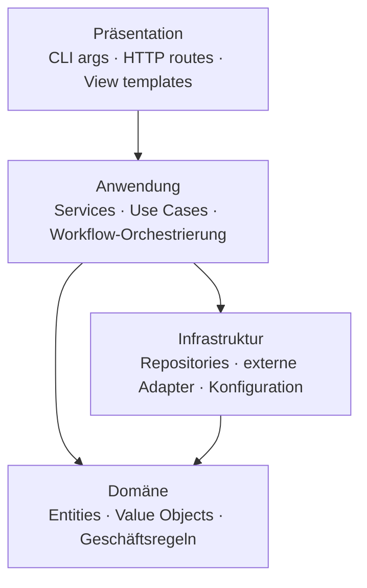

# Projekt-Layout – Revival_2026 (QR-Code-Videokanal)

Empfohlene Ordnerstruktur und Schichten-Modell. Stack-spezifische Architektur-Docs
(z. B. `architecture/CSHARP_PROJECT.md`, `RUST_PROJECT.md`, `PYTHON_WEB_PROJECT.md`,
`REACT_PROJECT.md`, `ASPNET_PROJECT.md`) präzisieren diese Vorgabe; base zeigt das
sprach-agnostische Skelett, die Regeln und den Schichtregel-Check.

Verbindet sich mit den Prinzipien [[SEPARATION_OF_CONCERNS]] und [[ORTHOGONALITY]].

---

## Schichten-Modell



**Regeln für Abhängigkeiten:**

- Pfeile zeigen erlaubte Aufrufrichtung (nur nach unten / nach innen).
- Domäne hat **keine** Abhängigkeiten zu Infrastruktur (DI-Inversion: Domäne
  definiert Interfaces, Infrastruktur implementiert).
- Präsentation hat **keine** direkten Aufrufe in Domäne oder Infrastruktur —
  geht immer über Services in der Anwendungsschicht.
- **Ausnahme Composition Root:** Der Einstiegspunkt (z. B. `Program.cs`, App-Factory, `main`)
  darf alle Schichten kennen, um sie zu verdrahten (DI-Registrierung, Konfiguration). Er
  enthält keine Fachlogik; Aufrufe aus Präsentationscode laufen weiterhin über die Anwendungsschicht.

---

## Layout dieses Projekts (Ist-Stand seit I7, Modulliste Stand I29)

Python 3.13 (requires-python `>=3.11`), Paketverwaltung `uv`, Build-Backend hatchling, **src-Layout**.

```
Revival_2026/
├── src/
│   ├── qrcodegenmod/            # Bibliothek (Domäne: QR-Kodierung V1–40, alle ECC-Stufen, Reader), seit I2
│   │   └── (Lookup-Tabellen werden beim Import berechnet und gecacht, kein .npy)
│   ├── qrvideo/                 # modernisierte PoC-Pipeline, seit I4/I6/I7
│   │                            #   Präsentation: cli.py, cli_handshake.py · Anwendung: encoder.py, decoder.py,
│   │                            #     handshake.py · Domäne: layout.py, container.py, erasure.py, errors.py,
│   │                            #     paths.py · Infrastruktur: crypto.py (GnuPG), videoio.py (ffmpeg),
│   │                            #     qrpng.py (PNG), channel.py (Kanal-Schnittstelle, ADR-005), youtube.py
│   └── qrvideo_gui/             # Desktop-GUI (Tkinter, ADR-004), seit I20a; importiert qrvideo, nie umgekehrt
│                                #   Präsentation: __main__.py, app.py, widgets.py, send_view.py,
│                                #     receive_view.py, handshake_view.py · Logik ohne Tk: keys.py, send.py,
│                                #     receive.py, handshake.py · jobs.py (Thread), errors.py (Texte)
├── tests/                       # pytest, flach: test_<modul>.py bzw. test_qrvideo_<thema>.py
├── bench/                       # Benchmark Original vs. Thesis-Mod (ms/QR)
├── legacy/                      # eingefrorener Thesis-Stand 2019 (Referenz, nicht ändern)
│   ├── qrcodegenmod.py, *.npy
│   └── poc/                     # POC.py, analyze_video.py, upload_video.py, _STARTE_POC.bat
├── tools/git-hooks/             # Interna-Hooks (pre-commit, commit-msg)
├── tools/i18n_catalog.py        # Kataloge extrahieren/abgleichen/kompilieren/prüfen (ADR-006, nur stdlib)
├── tools/screenshots.py         # GUI-Screenshots je Sprache für die Anleitungen (I33j, Pillow ad hoc)
├── tools/readme_graphics.py     # Logo + README-Grafiken als SVG aus bench/results.json (I35, nur stdlib)
├── docs/                        # Dieses Doku-Set
├── pyproject.toml, uv.lock
└── (venv NICHT hier: UV_PROJECT_ENVIRONMENT=%LOCALAPPDATA%\venvs\revival_2026, NextCloud-Sync)
```

Schichtzuordnung: `qrcodegenmod` ist reine Domäne ohne I/O außer dem Laden eigener Tabellen; `qrvideo` darf
`qrcodegenmod` importieren, nie umgekehrt; `qrvideo_gui` darf `qrvideo` importieren, nie umgekehrt. `legacy/` wird von `src/` nicht importiert.

## Regeln

- **Eine Datei pro Modul.** Module sind nach Verantwortung benannt, nicht nach Typ.
- **Bündelung nach Feature, nicht nach technischem Layer** ist akzeptabel, wenn
  innerhalb jedes Features die Schichten klar bleiben.
- **Imports gehen nur nach unten** entlang des Schichten-Graphen — keine zyklischen
  Abhängigkeiten zwischen Schichten.
- **Domäne kennt keine Infrastruktur-Typen** (ORM-Entities, HTTP-Clients).
  Wenn die Domäne persistieren muss → Repository-Interface in der Domäne,
  Implementierung in der Infrastruktur.
- **Tests parallel zur Quellstruktur.** Eine Test-Datei pro Modul.
- **Build-Output und Caches** gehören in `.gitignore`.

---

## Schichtregel als ausführbarer Check

Ein Schichten-Diagramm, das niemand prüft, driftet — besonders, wenn Agenten Code
schreiben. Sobald das Projekt mehr als eine Schicht oder mehrere Pakete/Module hat, wird
die Abhängigkeitsregel als **Test bzw. Gate** formuliert:

- **Werkzeug je Stack** (Beispiele): Python `import-linter` (Contracts in
  `pyproject.toml`), .NET `NetArchTest`/`ArchUnitNET` als Unit-Test, PowerShell ein
  Pester-Test über den AST (`Import-Module`/Dot-Sourcing nur nach unten), Rust ein
  Check über `cargo metadata`. Eine konkrete Umsetzung liefert bisher nur rust-cli
  (`architecture/RUST_PROJECT.md`, falls vorhanden); sonst wählt das Projekt das Werkzeug und trägt es hier ein. Dieses Projekt: `import-linter`, Contract
  `layers` in `pyproject.toml` (`qrvideo_gui` → `qrvideo` → `qrcodegenmod`), Gate 5 im pre-commit-Hook seit I25.
- **Registrierungspflicht:** Jedes Modul/Paket ist einer Schicht zugeordnet; ein
  unbekanntes Modul lässt den Check scheitern, statt durchzurutschen.
- **Der Check hat eigene Tests** (eine erlaubte und eine verbotene Beispielkante), sonst
  prüft er womöglich nichts.
- **Teil der Quality Gates** (`CONVENTIONS_COMMON.md` Abschnitt 5: läuft im selben Gate-Lauf mit, als Test in Gate 4
  oder eigener Befehl) — lokal und, falls vorhanden, in CI.

---

## Anti-Pattern

- **Business-Logik im Controller / im Template:** Routes/Views formatieren nur,
  sie entscheiden nicht.
- **Repository, das HTTP-Status zurückgibt:** Boundary-Vokabular in der
  Infrastruktur — Verstoß gegen Schichtung.
- **„Utils"-Ordner als Sammelbecken:** Funktionen ohne Schichten-Zuordnung
  sind ein Indikator, dass Verantwortung unklar ist.
- **Direkte Datenbank-Zugriffe aus mehreren Schichten:** nur Repositories
  dürfen Persistenz kennen.

---

## Pflege

Trigger (siehe `KICKOFF.md` Phase 3a): neue Schicht / Modul-Verschiebung
zwischen Schichten / neue stack-spezifische Layout-Variante → diese Datei
aktualisieren.
